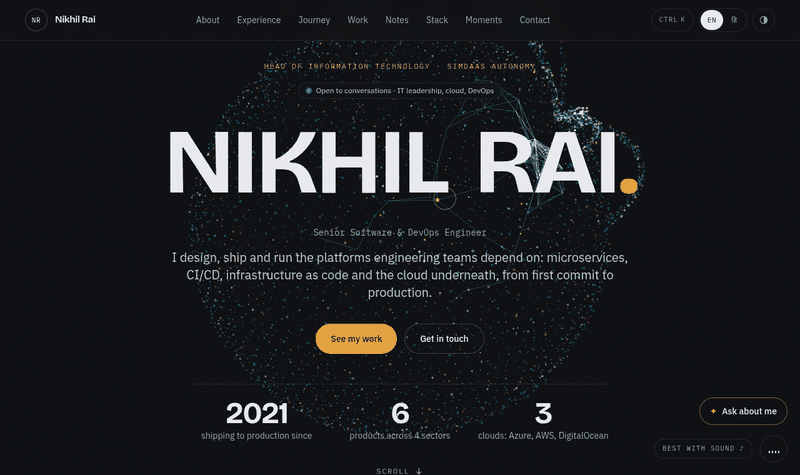
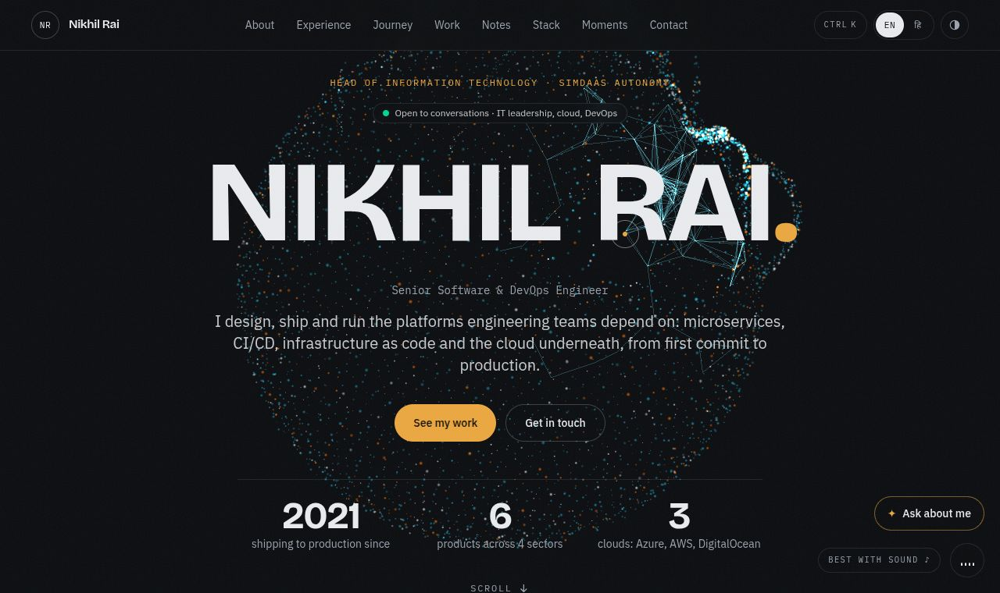
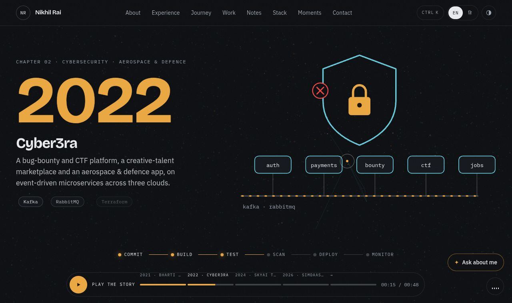
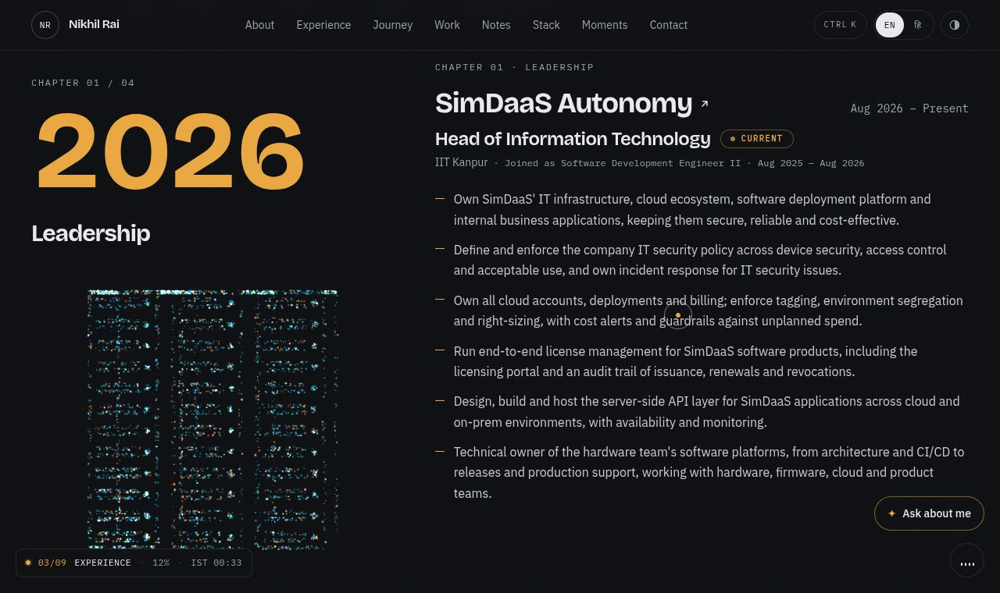
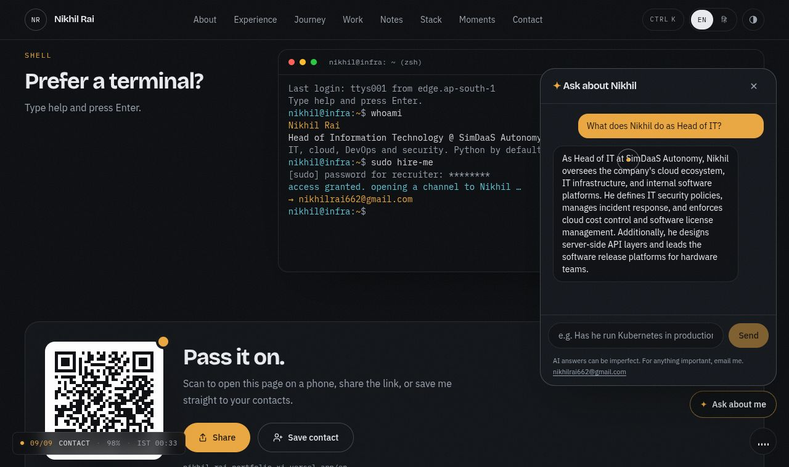
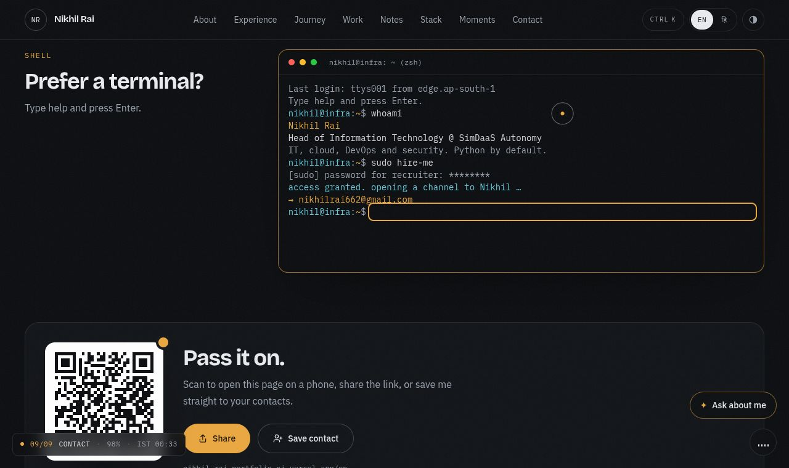
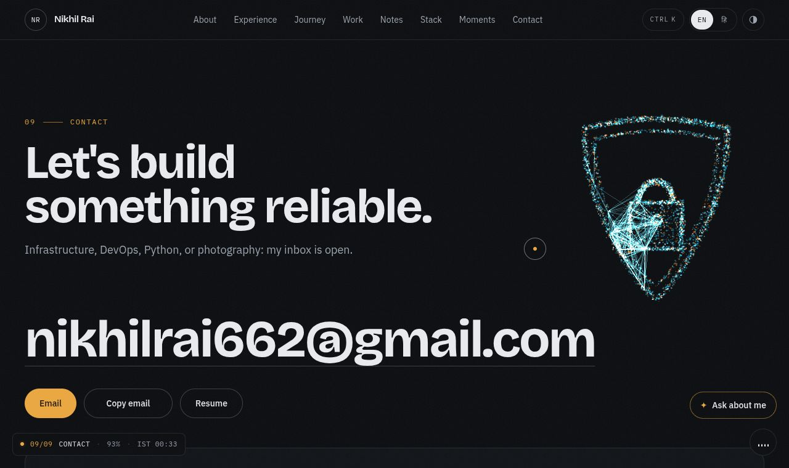
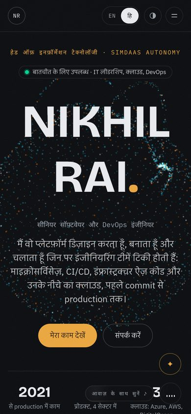
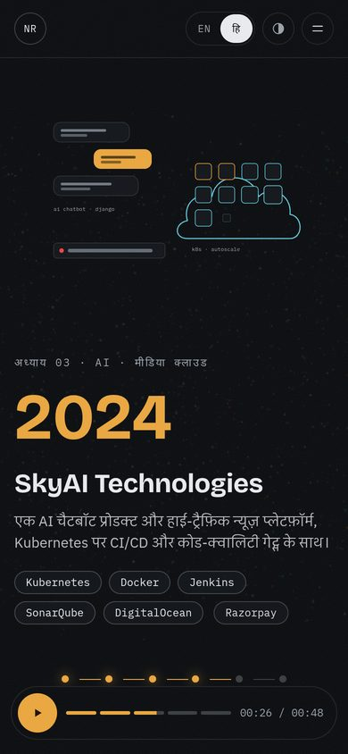
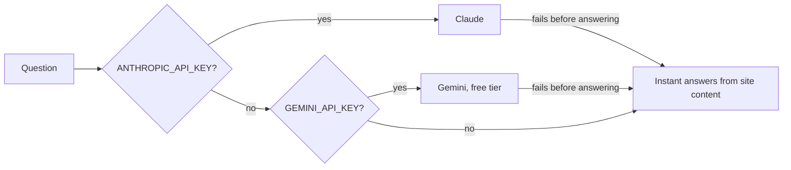

<div align="center">

# Nikhil Rai · Portfolio

**A developer portfolio that behaves like an app: GPU particles, a scroll film, generated music, an AI chat that never
breaks, streaming-app UX, PWA, English + हिन्दी.**
Open source, so you can learn how each piece works and build your own.

[**Live demo →**](https://nikhil-rai-portfolio-xi.vercel.app) &nbsp;·&nbsp; [Notes](https://nikhil-rai-portfolio-xi.vercel.app/en/notes) &nbsp;·&nbsp; [Make it yours](#make-it-yours-in-10-minutes)

[](https://github.com/nikhilrai-tech/portfolio/actions/workflows/ci.yml)
[](LICENSE)




</div>

> If this repo teaches you something, a ⭐ helps other people find it.

## Contents

- [What's inside](#whats-inside)
- [Tech stack](#tech-stack)
- [Quick start](#quick-start)
- [Make it yours in 10 minutes](#make-it-yours-in-10-minutes)
- [How it works (the interesting bits)](#how-it-works-the-interesting-bits)
- [Project structure](#project-structure)
- [Environment variables](#environment-variables)
- [Performance and accessibility](#performance-and-accessibility)
- [Deploy](#deploy)
- [Contributing, security, license](#contributing-security-license)

## What's inside

| | |
| --- | --- |
|  | **3D particle scene.** About 5,000 GPU particles morph per section: a globe with data arcs, a portrait sampled from a photo, server racks, a microservice mesh, a Kubernetes helm and a shield with a padlock. Particles move away from the cursor (or finger) and nearby nodes link up. |
|  | **The Journey, a scroll film.** The career told in chapters with animated SVG scenes and a CI/CD pipeline that lights up stage by stage. It has a video-style player: play, pause, chapter jumps, a timecode, and "Up next" at the end. |
|  | **Experience as chapters.** A sticky odometer year rolls 2026 → 2021 while server-rack particles sit beside it. |
|  | **"Ask about me" chat** grounded only in the site's content. It answers with Claude, or free with Google Gemini, or without any key from a built-in answer engine, so it never shows an error. |
|  | **A working terminal** (`help`, `whoami`, `experience`, `sudo hire-me`…), a **⌘K command menu**, and keyboard shortcuts on `?`. |
|  | **Contact that works:** an email form with spam protection (Resend), a QR code, native share, "Save contact" (vCard) and a shield of particles. |

**Streaming-app touches:** "Who's visiting?" profiles (recruiter, engineer, founder, explorer) with tailored **Top picks**,
**Continue watching** on a return visit, and **Up next** after the film.

**Everything else a modern site should have:** boot screen · custom cursor and magnetic buttons · generated music
(Web Audio, no files) · English and Hindi with automatic language detection · dark and light themes with a circular
reveal · installable **PWA** with an offline page · live **GitHub activity** · **Notes** with an RSS feed · rich share
cards · `llms.txt` for AI assistants · JSON-LD · security headers and `security.txt` · print stylesheet · privacy-friendly
analytics.

<p align="center">
  
  &nbsp;
  
</p>

## Tech stack

| Layer | Choice | Why |
| --- | --- | --- |
| Framework | **Next.js 16** (App Router, Cache Components) + **TypeScript** | Static pages, server components, route handlers, metadata |
| Styling | **Tailwind CSS v4** + CSS variables | Design tokens for both themes in one place |
| Motion | **GSAP** + ScrollTrigger + MotionPath, **Lenis** | Scroll-linked timelines, pinning, smooth scrolling |
| 3D | **three.js** (plain, lazy-loaded) with a custom shader | One `Points` draw call, no React 3D wrapper needed |
| Micro-interactions | **Framer Motion** (`LazyMotion`) | Menus, tilt cards, small transitions |
| Audio | **Web Audio API** | Music is synthesised live: nothing to download or license |
| AI | **Claude** (Anthropic SDK) or **Gemini** (REST), with a local fallback | Use the free tier or a paid model; keep working without either |
| Email | **Resend** | Contact form delivery |
| Hosting | **Vercel** | Deploys from `main`, preview URL per PR |

## Quick start

```bash
git clone https://github.com/nikhilrai-tech/portfolio.git
cd portfolio
npm ci
npm run dev        # http://localhost:3000 → redirects to /en or /hi
```

No keys are needed to run it locally. Checks used in CI: `npm run lint`, `npm run typecheck`, `npm run build`.

## Make it yours in 10 minutes

The code is MIT; the personal content is not (see [CONTENT-LICENSE.md](CONTENT-LICENSE.md)). Replace these and you
have your own site:

1. **Text:** `src/content/en.ts` and `src/content/hi.ts` (both follow the `Profile` type, so TypeScript tells you
   what's missing). Drop Hindi by removing it from `src/i18n/config.ts`, or add your own language the same way.
2. **Facts that don't change per language:** `src/content/shared.ts` (name, email, links, photos, tech stacks,
   LinkedIn posts, testimonials).
3. **Photos:** `public/images/portrait.jpg` (a plain background makes the best particle portrait) and
   `public/images/photography/` (strip EXIF/GPS first).
4. **Notes:** `src/content/notes.ts`.
5. **Resume and vCard:** `public/` (or set `resume` to `undefined` in `shared.ts`).
6. **Share cards:** edit `scripts/og-card.html` and run `scripts/render-og-cards.cjs` (instructions at the top).
7. **Colours and fonts:** tokens at the top of `src/app/globals.css`, fonts in `src/app/[lang]/layout.tsx`.

## How it works (the interesting bits)

<details>
<summary><b>1. Morphing particles on the GPU</b> · <code>src/components/three/</code></summary>

Every shape (`shapes.ts`) is the same number of points, so the vertex shader can blend any two. The portrait is sampled
from a photo at runtime: darker pixels and edges get more points, picked with a cumulative-weight binary search. Each
particle starts its move a little later than the last, which is what makes shapes dissolve and re-form instead of
sliding:

```glsl
float m = clamp((uMix - aRand * 0.35) / 0.65, 0.0, 1.0);
m = m * m * (3.0 - 2.0 * m);
vec3 p = mix(place(uA, uPlaceA), place(uB, uPlaceB), m);
```

Where a shape sits is decided by the page itself: any element with `data-shape-anchor` inside a section is measured each
frame and converted to world space. The cursor lines are drawn on the CPU from ~140 mirrored nodes, which avoids
reading positions back from the GPU.
</details>

<details>
<summary><b>2. A scroll film with a real player</b> · <code>src/components/journey/</code></summary>

One GSAP timeline holds every scene. A `ScrollTrigger` pins the stage and scrubs the timeline with scroll. "Play" is a
linear programmatic scroll through the same range (Lenis), so playing and scrolling are literally the same thing. Any
wheel or touch input pauses it, like grabbing a video's scrubber. Under reduced motion the scenes simply stack as a
normal section.
</details>

<details>
<summary><b>3. Music generated in the browser</b> · <code>src/lib/sound.ts</code></summary>

An 88 BPM lo-fi loop (kick, hats, bass, pad, plucks) built from oscillators, filtered noise and a synthetic reverb. A
look-ahead scheduler keeps timing tight even when the main thread is busy:

```ts
while (this.nextTime < ctx.currentTime + 0.12) {
  const s = this.step % 16;
  // …schedule this sixteenth note, then advance
}
```

On iOS a silent `<audio>` element moves playback to the media channel, so it plays even with the mute switch on.
</details>

<details>
<summary><b>4. An AI chat that never shows an error</b> · <code>src/app/api/ask/route.ts</code></summary>



The system prompt is generated from `src/content`, so the assistant can only say what the site already says. Answers
stream as plain text, and an `X-Ask-Mode` header lets the UI say honestly whether AI answered.
</details>

<details>
<summary><b>5. Two languages, one codebase</b> · <code>src/proxy.ts</code>, <code>src/app/[lang]/</code></summary>

`/` redirects to `/en` or `/hi` from a cookie, then the browser's `Accept-Language`. Every page is statically generated
per locale; content is typed, so a missing translation is a compile error.
</details>

<details>
<summary><b>6. PWA, offline, discoverability</b></summary>

`app/manifest.ts`, `public/sw.js` (network-first pages, cache-first hashed assets, `offline.html` fallback),
`sitemap.ts`, `robots.ts`, `feed.xml`, `llms.txt`, JSON-LD (Person, TechArticle) and pre-rendered share cards that chat
apps fetch fast enough to show.
</details>

## Project structure

```
src/
├── app/[lang]/            pages (home, notes), layout, 404, error
├── app/api/               contact (Resend) and ask (AI chat) routes
├── components/sections/   Hero, About, Experience, Journey, Work, Notes, Stack, Photography, Contact
├── components/three/      particle scene: canvas loader, shader, shapes
├── components/journey/    scroll film and its SVG scenes
├── components/ott/        who's visiting, top picks, continue watching
├── components/motion/     scroll effects, cursor, tilt, smooth scroll
├── components/ui/         boot screen, chat, terminal, command menu, HUD, share…
├── content/               all text (en, hi), notes, shared facts
├── lib/                   sound, GitHub data, chat context, theme, helpers
└── proxy.ts               locale routing
```

## Environment variables

Set them in Vercel → Project → Settings → Environment Variables, then redeploy. All are optional.

| Variable | Enables | Without it |
| --- | --- | --- |
| `NEXT_PUBLIC_SITE_URL` | Absolute URLs for share cards, sitemap, feed, QR | Falls back to `http://localhost:3000` |
| `RESEND_API_KEY` (+ optional `CONTACT_TO`, `CONTACT_FROM`) | Contact form email | Opens the visitor's mail app |
| `GEMINI_API_KEY` (+ optional `GEMINI_MODEL`) | AI chat on Google's free tier | Instant answers from content |
| `ANTHROPIC_API_KEY` | AI chat with Claude (takes precedence) | As above |
| `GITHUB_TOKEN` | Higher GitHub API limits for the activity block | Unauthenticated, cached hourly |

## Performance and accessibility

- three.js loads in its own chunk **after the page is idle**, and is skipped for reduced motion, Data Saver/2G and
  software-only WebGL (a static layout shows instead).
- Only `transform` and `opacity` are animated; text never depends on JavaScript to appear.
- Measured locally with Lighthouse (mobile): Accessibility, Best Practices and SEO **100**, Performance 88–93.
- Keyboard: everything is reachable; `⌘K`/`Ctrl K` menu, `?` shortcuts, `Esc` closes things and skips the intro.

## Deploy

Import the repo in Vercel (preset: Next.js). `main` deploys to production and every PR gets a preview URL. Add the
environment variables above and you're done.

## Contributing, security, license

- [CONTRIBUTING.md](CONTRIBUTING.md) · [CODE_OF_CONDUCT.md](CODE_OF_CONDUCT.md) · [SECURITY.md](SECURITY.md)
- Publishing your own portfolio repo? [docs/PUBLIC-REPO-CHECKLIST.md](docs/PUBLIC-REPO-CHECKLIST.md) is the checklist used here.
- **Code:** [MIT](LICENSE). **Content** (text, photos, resume, notes, share cards): © Nikhil Rai, see
  [CONTENT-LICENSE.md](CONTENT-LICENSE.md).

---

<div align="center">

Built by **Nikhil Rai**, Head of Information Technology at SimDaaS Autonomy.
[LinkedIn](https://www.linkedin.com/in/nikhil-rai-551219183/) · [GitHub](https://github.com/nikhilrai-tech) · [Email](mailto:nikhilrai662@gmail.com)

</div>
